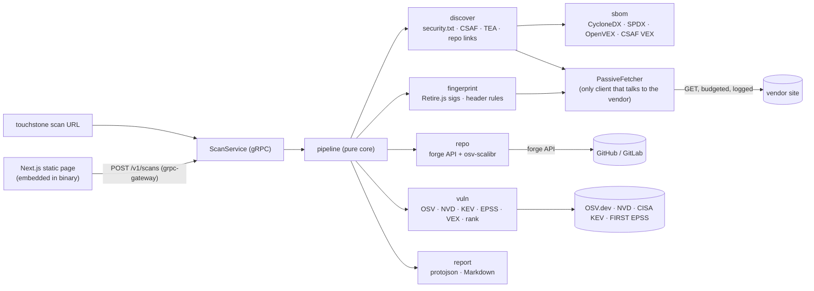

# Design: Touchstone

**Date:** 2026-10-22
**Status:** accepted
**PRD:** [`docs/product/touchstone.md`](../product/touchstone.md) (P0 stories #1–#5)
**Stack:** protobuf/gRPC (grpc-gateway) + Docker; Go 1.26 (engine, CLI, server) + TypeScript 5 / Next.js (current major) static export + Tailwind (web page)

## Problem

A third-party reviewer pastes a vendor URL and needs a CVE report graded by
evidence quality (vendor-declared SBOM/VEX → public repo → passive
fingerprint) within about a minute, without Touchstone ever sending a
request a browser wouldn't send. The engine must run identically as a CLI
and behind a single-page web UI, keep no history, and emit a versioned
JSON report the Containarium coding agent can consume later (PRD Phase 2).

**Requirements this design is sized to (from the PRD):** one URL per scan,
≤ 50 requests to the vendor per scan, p50 ≤ 60 s / p95 ≤ 3 min, single
user per instance (CLI or self-hosted web, no public instance in MVP), no
persisted state. Nothing here is sized for multi-tenant traffic; see
"At 10x" at the end.

## Design

One Go module, one binary (`touchstone`), one container. A modular
monolith: each evidence source is a package behind an interface, and a
pure pipeline core merges their output into a `ScanReport`.



### Components

| Package | Single responsibility | Story |
|---|---|---|
| `proto/touchstone/v1` | `ScanService` + `ScanReport`: the one contract for CLI, web, and Phase 2 agent | all |
| `internal/fetch` | `PassiveFetcher`: the **only** HTTP client that may contact the vendor. Enforces the passive rule, the request budget, SSRF guard, size caps; logs every request with the reason it was allowed | #1, #4 |
| `internal/discover` | Finds vendor-published evidence: `/.well-known/security.txt` (RFC 9116), CSAF provider metadata, `/.well-known/tea`, repo links in HTML, plus a user-supplied SBOM/VEX/repo | #1 |
| `internal/sbom` | Parses CycloneDX 1.5+, SPDX 2.3, OpenVEX, CycloneDX VEX, CSAF 2.0 VEX into normalized `Component` and `VexStatement` values. No I/O | #1, #2 |
| `internal/repo` | Resolves a public GitHub/GitLab repo to its latest release tag, fetches the tarball through the forge API, extracts lockfile dependencies with `osv-scalibr` | #3 |
| `internal/fingerprint` | Detects libraries from fetched page/asset bytes and headers: Retire.js signatures (`uri`, `filename`, `filecontent`, `hashes`) plus a small header rule table (`Server`, `X-Powered-By`). No I/O of its own | #4 |
| `internal/vuln` | `VulnSource` implementations (OSV by purl, NVD by CPE), KEV and EPSS enrichment, VEX application, ranking. Ranking is a pure function | #2 |
| `internal/pipeline` | Orchestrates sources concurrently, merges components across tiers (highest tier wins, all evidence kept, version conflicts recorded), never fails the whole scan because one source failed | all |
| `internal/report` | Builds the `ScanReport` proto; renders Markdown (escaping all vendor strings); JSON is `protojson` of the proto | #5 |
| `cmd/touchstone` | `scan` (CLI, prints JSON or Markdown) and `serve` (gRPC + grpc-gateway + embedded static web on one port) | #5 |
| `web/` | Next.js App Router, `output: "export"`, Tailwind. One URL input, report view grouped by tier. Embedded into the binary with `go:embed` | #5 |

### The passive rule is enforced in one place

`PassiveFetcher.Get(ctx, url, reason)` refuses any request whose `reason`
doesn't match one of four allowed kinds, and the reason is stored in the
report's `checked` list:

| Reason | Allowed URL |
|---|---|
| `TARGET` | the URL the user entered (and its redirects, re-checked) |
| `SUBRESOURCE` | a URL referenced by a fetched page as `<script src>`, `<link rel=stylesheet|modulepreload|preload>`, or CSS `@import`, i.e. what a browser would load |
| `DISCOVERY_PATH` | a fixed list on the target origin: `/.well-known/security.txt`, `/security.txt`, `/.well-known/csaf/provider-metadata.json`, `/.well-known/tea` |
| `DECLARED` | a URL named by a fetched discovery document (security.txt `CSAF:` field, CSAF provider metadata, TEA endpoint list) |

Always: `GET` only, never a synthesized query string or path, descriptive
`User-Agent: Touchstone/<ver> (+https://github.com/FootprintAI/touchstone)`,
budget default 50 (hard max 200), 2 MiB per response and 20 MiB per scan,
10 s per request. **SSRF guard:** loopback, RFC 1918, link-local
(including `169.254.169.254`), CGNAT and IPv6 ULA destinations are refused
at dial time via `net.Dialer.Control`, so DNS rebinding and redirects to
internal hosts are caught too. `--allow-private` exists for the CLI only
(testing against a local fixture); `serve` never honors it.

Forge API calls (#3) and vulnerability-database calls (#2) don't touch the
vendor and use separate clients with their own timeouts. They don't count
against the vendor budget.

### Evidence discovery: what "published SBOM" means in practice

PRD open question 1 asked which discovery locations count. Checked
2026-10-22:

- **RFC 9472** (the published form of `draft-ietf-opsawg-sbom-access`)
  extends MUD/YANG for devices. It doesn't apply to websites. **Not used.**
- **security.txt (RFC 9116) + CSAF 2.0 (OASIS).** CSAF defines a `CSAF:`
  field in security.txt and `/.well-known/csaf/provider-metadata.json`,
  pointing to advisories that can carry the VEX profile. **Used:** CSAF
  VEX documents give per-product, per-CVE status. That's High tier.
- **Transparency Exchange API (TEA)**, CycloneDX/Ecma TC54 TG1:
  `/.well-known/tea` lists API endpoints, but querying needs a TEI
  (`tei://<domain>/<type>/<id>`) that the vendor assigns, and a site URL
  doesn't give us one. **MVP: fetch and record `/.well-known/tea` only.**
  Querying is P1, once we learn where vendors publish TEIs.
- **No standard exists for pointing from a web page to its SBOM.** Treating
  arbitrary `<link>`/`<meta>` tags as SBOM pointers would be guessing.
  **Not used.**

So the High tier will often be empty from discovery alone, which confirms
the PRD's A2 risk. **This design adds one input the PRD doesn't name: an
SBOM/VEX the reviewer already has** (URL or uploaded file, from a vendor
questionnaire). It's High tier, and in vendor reviews it's the most likely
way to get an SBOM. Accepted as decision D1; PRD Story 1 amended.

### Fingerprinting: Retire.js signatures in Go

Tested 2026-10-22 against `jsrepository-v4.json` (76 libraries, 402 regex
patterns outside `func`/`ast`): **11 fail to compile under Go's RE2**,
including jQuery, React, Vue, Lodash and Next.js. They use backreferences,
lookbehind and repeat counts over 1000. Those are exactly the libraries
that matter most, so the fingerprinter compiles patterns with
`github.com/dlclark/regexp2` in ECMAScript mode. regexp2 backtracks, and
the JS it scans is attacker-controlled, so every match runs with
`MatchTimeout = 100ms` and the 2 MiB per-asset cap. A timeout is recorded
as a fingerprint error, never a crash.

Not used: `func` extractors (they need JS execution, which breaks the
passive rule and adds a sandbox) and `ast` extractors (they need a JS
parser; P1 if coverage needs it). The signature file is a pinned snapshot
vendored under `internal/fingerprint/data/` and embedded; a scheduled CI
job opens a PR when upstream changes.

Server banners map to CPEs through a hand-written table
(`Apache/x.y.z` → `cpe:2.3:a:apache:http_server:x.y.z`, nginx, IIS, PHP,
Express). Every banner-derived component carries the caveat
`MAY_BE_BACKPORTED`.

### Data flow and failure paths

1. Validate the URL (http/https only, public host after resolution).
2. `TARGET` fetch. If it fails (DNS, TLS, 4xx/5xx, SSRF refusal), the
   report has `scan_status = TARGET_UNREACHABLE`, the error, and nothing
   else. Not an RPC error: the report itself is the answer.
3. In parallel, with a shared budget: discovery (#1) → SBOM/VEX parse;
   repo (#3) if a repo link was found or supplied; fingerprint (#4) over
   the target page and its subresources.
4. Merge components: key is purl, else CPE, else name. Higher tier wins;
   evidence from every tier is kept. When tiers disagree on version
   (fingerprint says jQuery 3.4.1, SBOM says 3.7.1), both are kept and a
   `Conflict` is recorded, since "deployed ≠ declared" is itself a finding.
5. Vulnerability lookup: OSV `querybatch` by purl, then `GET /v1/vulns/{id}`
   for details; NVD 2.0 by CPE for components without a purl
   (`NVD_API_KEY` optional; without it NVD allows about 5 requests per
   30 s, so CPE lookups are capped and the cap is reported). Then KEV
   (feed cached in memory, 6 h TTL) and EPSS. Apply VEX; rank KEV first,
   then EPSS descending, then CVSS.
6. Each external source reports a `SourceStatus`. If any vulnerability
   source fails, `lookup_status = PARTIAL` or `FAILED`, and both
   renderers show "lookup incomplete" instead of a count. A clean-looking
   "0 CVEs" is impossible unless `lookup_status = COMPLETE`.
7. Render JSON or Markdown, or return to the web page. Nothing is stored.

The whole scan runs under one context: 180 s deadline for `serve`,
configurable for the CLI.

### Deployment shape

- **Dockerfile** (multi-stage): `node:20` builds `web/` to static files →
  `golang:1.26` builds `touchstone` with them embedded →
  `gcr.io/distroless/static` runtime, non-root. One image, two commands.
- **docker-compose.yml** for local dev and e2e: `touchstone serve` plus
  `fixture-vendor` (nginx serving `test/fixtures/sites/*`, with request
  logging) on an internal network. Compose passes `--allow-private` only
  to the e2e runner's CLI invocation, never to `serve`.
- **Config:** env vars only. `NVD_API_KEY`, `GITHUB_TOKEN`, `GITLAB_TOKEN`
  (all optional, raise rate limits), `TOUCHSTONE_ADDR` (default
  `127.0.0.1:8080`: local-only unless the operator opts in),
  `TOUCHSTONE_MAX_CONCURRENT_SCANS` (default 2). No secrets in images.
- **No database.** The only state is the in-memory KEV cache.
- **CLI distribution:** GoReleaser binaries plus the container image. The
  npm package `@footprintai/touchstone` from the PRD is dropped: it would
  only wrap a Go binary (see D2).

## Language choices

| Component | Language | Why this one | Type gate in CI |
|---|---|---|---|
| Engine, CLI, server (`cmd/`, `internal/`) | Go | Single static binary for the CLI; the libraries that do the hard parts are Go (`osv-scalibr`, `cyclonedx-go`, `spdx/tools-golang`, `openvex/go-vex`); concurrent bounded fetching | `go vet`, `go build`, `staticcheck` |
| Web page (`web/`) | TypeScript | The browser | `tsc --noEmit` with `strict` + `noUncheckedIndexedAccess` |

Two languages, no Python. Nothing here is ML or data-pipeline work.

## Contracts

**One proto, `proto/touchstone/v1/scan.proto`, is the source of truth** for
the CLI's JSON output, the REST API, the web page's types and the Phase 2
agent integration. `buf generate` produces:

- Go: `protoc-gen-go`, `protoc-gen-go-grpc`, `protoc-gen-grpc-gateway`
- TypeScript: `protoc-gen-es` (protobuf-es v2) → `web/src/gen/`. The web
  page decodes responses with `fromJson(ScanReportSchema, body)`, the
  generated parser, so no `as ScanReport` casts exist. `include_imports`
  also generates `web/src/gen/google/api/*_pb.ts`, which `scan_pb.ts`
  imports for the HTTP annotation (well-known types come from
  `@bufbuild/protobuf/wkt`)
- `protoc-gen-openapiv2` → `openapi/touchstone_v1.swagger.json`
  (`merge_file_name=touchstone_v1`; the plugin appends `.swagger.json`),
  published for third parties
- JSON Schema of `ScanReport` (Buf's `protoschema-jsonschema` plugin,
  `json-bundle` target) → `schema/scan-report.v1.json`: the "published,
  versioned schema" from Story #5. The plugin names its output after the
  message, so `make generate` renames
  `schema/touchstone.v1.ScanReport.jsonschema.bundle.json` to that stable
  name. The bundles for the messages `ScanReport` references
  (`schema/touchstone.v1.<Message>.jsonschema.bundle.json`) are also
  committed generated outputs

**Reproducible generation.** `make generate` wraps `buf generate` plus the
schema rename above; run it rather than `buf generate` alone. The plugins
are remote buf plugins with pinned versions (`buf.gen.yaml`), `clean: true`
wipes each output directory before writing, and `buf.lock` pins
googleapis (`buf dep update` to bump it). Generated code lives in `gen/`,
`web/src/gen/`, `openapi/` and `schema/`, is committed, and is never edited
by hand; CI fails if `make generate` produces a diff.

```proto
syntax = "proto3";
package touchstone.v1;

import "google/api/annotations.proto";
import "google/protobuf/timestamp.proto";

service ScanService {
  rpc Scan(ScanRequest) returns (ScanReport) {
    option (google.api.http) = { post: "/v1/scans" body: "*" };
  }
}

message ScanRequest {
  string url = 1;                 // required, http(s)
  string repo_url = 2;            // optional, user-supplied repo (#3)
  string sbom_url = 3;            // optional, user-supplied SBOM/VEX (D1)
  bytes  sbom_document = 4;       // optional, uploaded SBOM/VEX (D1)
  uint32 request_budget = 5;      // 0 = default 50, max 200
}

enum Confidence { CONFIDENCE_UNSPECIFIED = 0; CONFIDENCE_LOW = 1; CONFIDENCE_MEDIUM = 2; CONFIDENCE_HIGH = 3; }
enum EvidenceKind {
  EVIDENCE_KIND_UNSPECIFIED = 0; EVIDENCE_KIND_SBOM_PUBLISHED = 1; EVIDENCE_KIND_SBOM_SUPPLIED = 2;
  EVIDENCE_KIND_VEX = 3; EVIDENCE_KIND_REPO_LOCKFILE = 4; EVIDENCE_KIND_FINGERPRINT_ASSET = 5;
  EVIDENCE_KIND_FINGERPRINT_HEADER = 6;
}
enum VexStatus { VEX_STATUS_UNSPECIFIED = 0; VEX_STATUS_AFFECTED = 1; VEX_STATUS_NOT_AFFECTED = 2; VEX_STATUS_FIXED = 3; VEX_STATUS_UNDER_INVESTIGATION = 4; }
enum ScanStatus { SCAN_STATUS_UNSPECIFIED = 0; SCAN_STATUS_OK = 1; SCAN_STATUS_TARGET_UNREACHABLE = 2; }
enum LookupStatus { LOOKUP_STATUS_UNSPECIFIED = 0; LOOKUP_STATUS_COMPLETE = 1; LOOKUP_STATUS_PARTIAL = 2; LOOKUP_STATUS_FAILED = 3; }

message Evidence {
  EvidenceKind kind = 1;
  string location = 2;            // URL, or repo@ref:path for lockfiles
  string detail = 3;              // matched string or header value
}

message Vulnerability {
  string id = 1;                  // CVE id when one exists, else OSV id
  repeated string aliases = 2;
  string summary = 3;
  bool   kev = 4;
  optional double epss = 5;       // absent = no EPSS data
  optional double cvss_base = 6;
  VexStatus vex_status = 7;
  string vex_justification = 8;
  bool   suppressed = 9;          // true for NOT_AFFECTED / FIXED
}

message Component {
  string name = 1;
  string version = 2;
  string purl = 3;
  string cpe = 4;
  Confidence confidence = 5;
  repeated Evidence evidence = 6;
  repeated string caveats = 7;    // e.g. MAY_BE_BACKPORTED, DEFAULT_BRANCH_NOT_RELEASE
  repeated Vulnerability vulnerabilities = 8;  // ranked
}

message Conflict { string component_key = 1; repeated string versions = 2; repeated Evidence evidence = 3; }

message CheckedLocation {
  string url = 1;
  string reason = 2;              // TARGET | SUBRESOURCE | DISCOVERY_PATH | DECLARED | FORGE_API
  enum Result { RESULT_UNSPECIFIED = 0; RESULT_FOUND = 1; RESULT_NOT_FOUND = 2; RESULT_ERROR = 3; RESULT_REFUSED = 4; }
  Result result = 3;
  string error = 4;
}

message SourceStatus { string source = 1; bool ok = 2; string error = 3; }

message ScanReport {
  string schema_version = 1;      // "1"; bumped only with a new proto package
  string target_url = 2;
  ScanStatus scan_status = 3;
  LookupStatus lookup_status = 4;
  google.protobuf.Timestamp started_at = 5;
  google.protobuf.Timestamp completed_at = 6;
  string tool_version = 7;
  google.protobuf.Timestamp vuln_data_as_of = 8;
  repeated Component components = 9;
  repeated Conflict conflicts = 10;
  repeated CheckedLocation checked = 11;
  uint32 requests_used = 12;
  uint32 request_budget = 13;
  repeated SourceStatus sources = 14;
  string disclaimer = 15;
}
```

**Internal Go seams** (interfaces, so each source tests against fakes):
`fetch.Fetcher`, `vuln.Source` (OSV, NVD), `vuln.Enricher` (KEV, EPSS),
`repo.Forge` (GitHub, GitLab), and `pipeline.EvidenceSource` (discover,
repo, fingerprint, supplied). Wire formats from outside (OSV, NVD, KEV,
EPSS, forge APIs, CSAF) get named Go structs decoded with
`DisallowUnknownFields` off but strict required-field checks; no
`map[string]any` plumbing.

## Test strategy

| Component | Unit tests (table-driven) | Contract / integration | Mocked vs real |
|---|---|---|---|
| `fetch` | `TestAllowReason`: each reason kind × allowed/refused URL; `TestBudget`: request 51 refused at budget 50; `TestSizeCap`; `TestSSRFGuard`: loopback, 10/8, 169.254.169.254, `::1`, fc00::/7, DNS name resolving to private, redirect to private: all `REFUSED` | `httptest` server: every request carries the UA, method is GET, no query added | Real `httptest` servers; DNS via injected resolver |
| `discover` | security.txt parsing (RFC 9116 fixtures incl. multiple `CSAF:` fields, comments, CRLF); repo-link extraction from HTML (github/gitlab, ignores share/badge links); TEA document recorded, not followed | Fixture site served by `httptest`, asserting the exact `checked` list | Fake `Fetcher` for unit, real fetcher + `httptest` for integration |
| `sbom` | Golden tests: each fixture (CycloneDX 1.5/1.6 JSON, SPDX 2.3 JSON, OpenVEX, CycloneDX VEX, CSAF VEX) → expected normalized components/statements; malformed input → typed error, no panic | Fuzz test (`go test -fuzz`) on each parser | None, pure |
| `repo` | Release-tag selection (semver, prerelease ignored, no releases → default branch + caveat); no lockfile → explicit status | `osv-scalibr` over fixture repo tarballs (npm, pip, go.mod, Maven lockfiles) | Fake `Forge`; real scalibr on fixtures |
| `fingerprint` | Per-library golden: fixture asset bytes → (lib, version); header table rows; backport caveat present on every banner component | **Signature-load test:** every non-`func`/`ast` pattern in the vendored file compiles under regexp2. **ReDoS test:** pathological input finishes within timeout and reports an error | None, pure over bytes |
| `vuln` | `TestRank`: KEV > EPSS > CVSS ordering, missing EPSS sorts last; `TestApplyVEX`: each status → suppressed/visible; `TestLookupStatus`: any source error → never `COMPLETE` | Recorded responses (OSV, NVD, KEV, EPSS) replayed by `httptest`; one opt-in live smoke test (`-tags live`) run nightly, not on PRs | Fakes on PRs; live only in the nightly job |
| `pipeline` | Merge rules: tier precedence, evidence union, version conflict recorded; one source erroring leaves the others' components | Full pipeline over fakes for every source | All sources faked |
| `report` | Markdown golden files; vendor strings with Markdown/HTML injection are escaped; disclaimer and metadata always present; `lookup_status != COMPLETE` never renders a count | `protojson` output validates against `schema/scan-report.v1.json` | None |
| Proto contract | `buf lint`, `buf breaking --against main`, generated-code-is-current check | **Cross-language golden:** Go writes `testdata/report.golden.json`; a Vitest test decodes the same file with `fromJson(ScanReportSchema, …)`, so drift fails a test on either side | None |
| `web/` | Vitest + Testing Library: tier grouping, "lookup incomplete" banner, evidence expanders, URL validation | Vitest against the gateway's OpenAPI-documented route with a mocked `fetch` returning the golden JSON | `fetch` mocked |
| End to end | | `docker compose up` → CLI and web both scan `fixture-vendor` → **identical JSON** (#5 AC); **nginx request log ⊆ allowed set** (#4 AC, the passive proof); happy path via `/qa-e2e-test` | Real everything except vulnerability feeds, which are recorded |

CI gate on every PR: `go vet`, `staticcheck`, `go test ./...`, `buf lint`,
`buf breaking`, generated-code check, `tsc --noEmit`, `vitest run`,
`next build`, image build. The compose e2e runs on PRs touching
`fetch`, `pipeline`, `cmd/` or `web/`, and nightly.

What runs today (`.github/workflows/ci.yml`, on every PR and on pushes to
`main`):

- job `go`: `go vet ./...`, `staticcheck`, `go test ./...`
- job `proto`: `buf lint`; `buf breaking` against `origin/main` when `main`
  has a `buf.lock` (it now does, so the check is live); the generated-code
  check (`make generate`, then fail on any diff under `gen/`,
  `web/src/gen/`, `openapi/` and `schema/`)
- job `web`: `npm install --no-package-lock`, `tsc --noEmit`, `vitest run`

Not yet in CI: `next build` arrives with S9 and the image build with S10,
as does the compose e2e.

**Known follow-up:** there is no `web/package-lock.json` yet, so CI runs
`npm install --no-package-lock` against the exact versions pinned in
`web/package.json`. Commit a lockfile and switch CI to `npm ci`.

**Precision metric (PRD metric 1):** not a unit test. A separate
`accuracy/` harness runs the CLI over the hand-labelled 30-site corpus
and reports precision per tier. It's built when the corpus exists, not in
the MVP slices below.

## Delivery slices

Each slice is one future issue, mapped to its PRD story issue. Sizes per
`_shared/estimates.md`; all uncalibrated (first sprint).

| # | Slice | Story | Size | Acceptance criterion |
|---|---|---|---|---|
| S0 | **Contract first:** `scan.proto`, `buf generate` (Go, TS, OpenAPI, JSON Schema), stub `ScanService` returning a canned report, `touchstone scan` printing it, CI gates, `Fetcher`/`Source`/`EvidenceSource` interfaces with fakes | all | M | `touchstone scan https://x` prints canned JSON that validates against the generated schema; CI green with every gate listed above |
| S1 | `PassiveFetcher`: reason allowlist, budget, caps, SSRF guard, UA, request log | #1, #4 | M | All `fetch` unit tests pass, including every SSRF case |
| S2 | **Walking skeleton:** target fetch → header + Retire `uri`/`filename` fingerprint → OSV by purl → `protojson` report from the CLI | #4, #2 | M | CLI against a fixture page loading `jquery-1.12.4.min.js` reports it Low confidence with at least one OSV id |
| S3 | Vulnerability matching complete: NVD CPE fallback, KEV, EPSS, ranking, `lookup_status` | #2 | M | `vuln` tests pass; with OSV down, the report says `PARTIAL` and shows no count |
| S4 | SBOM/VEX parsers: CycloneDX, SPDX, OpenVEX, CycloneDX VEX, CSAF VEX; VEX application wired into `vuln` | #1, #2 | L | Golden tests pass for every format; a `not_affected` statement suppresses its CVE in the report |
| S5 | Discovery: security.txt, CSAF provider metadata, TEA record, repo links, user-supplied SBOM/VEX/repo | #1 | M | Fixture site with security.txt → CSAF VEX yields High components; `checked` lists every probed location |
| S6 | Repo scan: forge release resolution, tarball, `osv-scalibr` lockfiles | #3 | M | Fixture repo with `package-lock.json` at tag `v1.2.0` yields Medium components with `repo@v1.2.0:package-lock.json` evidence |
| S7 | Fingerprint complete: `filecontent` and `hashes` extractors with regexp2 + timeout, header CPE table, backport caveat | #4 | M | Signature-load and ReDoS tests pass; React and Vue fixture bundles are detected by content |
| S8 | Markdown export with disclaimer and metadata, escaping | #5 | S | Markdown golden tests pass, including an injection fixture |
| S9 | Web page: Next.js static export, URL input, report view, embedded in `serve` via grpc-gateway | #5 | M | Vitest suite passes; `touchstone serve` returns the page and `POST /v1/scans` works from it |
| S10 | Docker image, compose with `fixture-vendor`, e2e: CLI = web JSON, request log ⊆ allowed set | #4, #5 | M | The compose e2e passes in CI |

**Remaining chain:** `S0 → S1 → S2 → S10`.
- S0 → everything: every slice builds against the generated types and
  interfaces. Hours of work; merge it first.
- S1 → S2: the walking skeleton is only a real end-to-end path with the
  real fetcher. (S5 and S7 test against the fake fetcher and don't wait
  for S1.)
- S2 → S10: the e2e needs a working pipeline. S10 also picks up whatever
  of S3–S9 has merged; it doesn't wait for all of them to start, and its
  passive-proof assertion is independent of the other slices.

After S0, slices S1, S3, S4, S5, S6, S7, S8 and S9 can run in parallel.
S3 and S4 both touch `internal/vuln`: S4's VEX application goes in its own
file behind `vuln.ApplyVEX` to avoid conflicts.

## Decisions (accepted 2026-10-22)

| # | Decision | Outcome |
|---|---|---|
| D1 | Add **reviewer-supplied SBOM/VEX** (URL or upload) as a High-tier input; discovery alone will rarely find an SBOM | **Accepted.** PRD Story 1 amended |
| D2 | Drop the npm package; ship GoReleaser binaries + container image | **Accepted.** PRD name line amended |
| D3 | `serve` binds `127.0.0.1` by default, no auth (no public instance per PRD OQ3) | **Accepted** |

## Deviations from the default stack

- **Next.js as a static export, served by the Go binary**, not a Next.js
  server. Within the stack, but noting it: one page with no server-side
  needs doesn't justify a second runtime in production.
- **`dlclark/regexp2`** for Retire.js patterns instead of Go's `regexp`.
  Not a language deviation, but it gives up RE2's linear-time guarantee.
  Contained to `internal/fingerprint`, with a 100 ms match timeout and the
  2 MiB input cap.
- **No database.** The PRD forbids scan history, and nothing else needs
  persistence.

Otherwise none.

## Rejected alternatives

1. **Orchestrate existing CLIs** (shell out to `osv-scanner`, `retire`,
   a Wappalyzer port). Each brings its own HTTP client, so the passive rule
   and the request budget can't be enforced in one place, and the result
   needs Go + Node + more in one image. We use their *data and libraries*
   (`osv-scalibr`, Retire.js signatures) instead.
2. **TypeScript engine** (Retire.js runs natively, types shared with the
   UI). Loses `osv-scalibr`, `cyclonedx-go`, `spdx/tools-golang` and
   `go-vex`, which are the hard parts, and the single static CLI binary.
   The regex problem costs one dependency in Go; the parsing problem would
   cost reimplementation in TypeScript.
3. **Async jobs with a queue and polling.** Not needed for one user, one
   URL, ≤ 3 min, no history. A unary RPC with a deadline is enough.

## At 10x (a public hosted instance)

What would change: an async job API with server-streaming progress; auth
and per-user rate limits (an open URL fetcher is an abuse vector); egress
through a dedicated proxy with its own IP reputation; a shared cache for
OSV/NVD/KEV/EPSS lookups (NVD rate limits bind first); and a scan-history
store, which the PRD currently rules out. That's the Phase 2 cloud scope,
where a Containarium box gives egress control and an audit trail.
